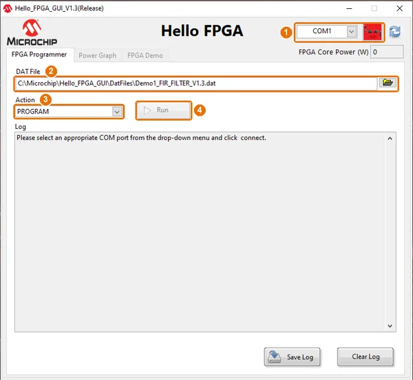

.. SPDX-FileCopyrightText: Copyright Bavariamatic GmbH
.. SPDX-License-Identifier: Apache-2.0

.. zephyr:board:: m2s_hello_fpga_kit

Overview
********

The Microchip M2S Hello FPGA Kit (``M2S-HELLO-FPGA-KIT``) is an entry-level board with a
SmartFusion2 SoC FPGA **M2S010-VF256**. Zephyr runs on the Arm Cortex-M3 of the SmartFusion2
Microcontroller Subsystem (MSS).

The kit is built around three parts that matter for Zephyr:

- the **SmartFusion2 M2S010** (Cortex-M3, 256 KB eNVM, 64 KB eSRAM, FPGA fabric),
- a **PIC32MX795F512L** with an **MCP2221A** USB-UART bridge. The PIC32 programs the FPGA, measures
  the FPGA core power and is the only path between the USB port and the SmartFusion2 console UART,
- the **Hello FPGA GUI**, the Windows application from Microchip that talks to the PIC32 and
  programs the board.

The kit has no on-board debug probe for the Cortex-M3: images are not flashed with
``west flash``, see :ref:`m2s_hello_fpga_kit_programming`.

.. important::

   The SmartFusion2 is an FPGA. The Cortex-M3 only runs once a Libero SoC design that configures
   the MSS (clocks, peripherals, routing of the MSS peripherals to pins) is programmed into the
   device. The pins of every MSS peripheral therefore depend on that Libero design, not on this
   board definition. The Zephyr image is stored in the eNVM as part of the same programming file.

Hardware
********

- SmartFusion2 M2S010-VF256: Arm Cortex-M3, 256 KB eNVM, 64 KB eSRAM, FPGA fabric
- PIC32MX795F512L: FPGA programming, FPGA core power monitor (PAC1710), USB bridge to MMUART_0
- MCP2221A: USB 2.0 (Mini-B) to UART bridge for the PIC32
- SST26VF064B (U8): 64 Mbit serial flash on SmartFusion2 fabric I/Os
- three debug LEDs on the SmartFusion2 (LD1–LD3), two LEDs on the PIC32 (LD4, LD5)
- three push buttons
- Arduino Uno compatible header (J7), two 20-pin expansion headers, JTAG header (J4)
- camera sensor board and LCD board (used by the Microchip demos)

Supported Features
==================

.. zephyr:board-supported-hw::

Connections and IOs
===================

The board devicetree enables ``uart0`` (MMUART_0, console and shell) and ``gpio0`` (MSS GPIO).
``i2c0``, ``i2c1``, ``spi0`` and ``spi1`` are defined in the SoC devicetree and can be enabled in
an application overlay once the Libero design routes them.

Fixed connections on the kit (schematic Rev. 1):

.. list-table::
   :header-rows: 1

   * - Function
     - SmartFusion2 ball
     - Kit net / part
     - Notes
   * - MMUART_0 TX / RX
     - H12 / H13
     - ``UART_TX_SF2`` / ``UART_RX_SF2``
     - To the PIC32, not to USB directly. Route MMUART_0 through the fabric to these balls.
   * - LD1 / LD2 / LD3
     - T12 / T13 / G13
     - ``LED1_DEBUG`` / ``LED2_DEBUG`` / ``LED3_DEBUG``
     - **Active low**: anode at 3.3 V, 330 Ω to the pin.
   * - U8 SST26VF064B C / SI / SO / CS#
     - T6 / M9 / N10 / M7
     - ``SPI_FLSH_*``
     - W# (R6) and HOLD# (M8) have 10 kΩ pull-ups.
   * - Arduino SDA / SCL
     - P8 / R8
     - J7-9 / J7-10
     - **No pull-up resistors** on the kit.
   * - Arduino D13 / D11 / D12 / D10
     - R13 / R11 / T11 / M10
     - J7-6 / J7-4 / J7-5 / J7-3
     - For example SPI_0 SCK / MOSI / MISO / SS0 through the fabric.

The dedicated MSS pads of SPI_0 (J12, J13, J14, K12) and I2C_1 (H16, J16) are wired to the PIC32,
not to a connector. To use these peripherals on the Arduino header, connect them to the fabric in
the Libero design.

The PAC1710 power monitor (U2) is on the I2C bus of the PIC32 only and cannot be read from the
SmartFusion2.

The design used to test this page connects the MSS peripherals as follows (all through the
fabric): MMUART_0 to H12/H13, GPIO_0..2 to LD1–LD3, I2C_0 to the Arduino SDA/SCL, SPI_0 to Arduino
D13/D11/D12/D10 and SPI_1 to U8.

System Clock
============

Zephyr does not program the SmartFusion2 clock tree. The clocks are set in the Libero design (MSS
Clock Conditioning Circuit) and the devicetree must describe them. The board devicetree assumes:

.. list-table::
   :header-rows: 1

   * - Clock
     - Frequency
     - Devicetree
   * - M3_CLK
     - 100 MHz
     - ``&cpu0 { clock-frequency = <100000000>; }``
   * - APB_0 / APB_1 (PCLK)
     - 50 MHz
     - ``&clkc { clock-frequencies = <100000000 50000000>; }``

``CONFIG_SYS_CLOCK_HW_CYCLES_PER_SEC`` and the SmartFusion2 ``SystemCoreClock`` are derived from
``&cpu0``. The UART clock comes from ``&clkc``, the other MSS peripherals use their own
``clock-frequency`` properties. If the Libero design uses other clocks, describe them in an
overlay; changing the devicetree does not reprogram the hardware:

.. code-block:: devicetree

   &cpu0 {
      clock-frequency = <80000000>;
   };

   &clkc {
      clock-frequencies = <80000000 40000000>;
   };

Serial Port
===========

The console (``uart0``, MMUART_0) does not reach the PC directly. It goes through the PIC32, which
runs two UART links at different bit rates:

.. graphviz::
   :caption: Console path of the M2S Hello FPGA Kit

   digraph console {
      rankdir=LR;
      node [shape=box, style=rounded, fontname="Helvetica", fontsize=11];
      edge [fontname="Helvetica", fontsize=10, dir=both];

      pc     [label="Host PC\n(serial port of the MCP2221A)"];
      mcp    [label="MCP2221A\nUSB-UART"];
      pic    [label="PIC32MX795F512L\nbridge, forwards only\nafter '&' from the host"];
      sf2    [label="SmartFusion2\nMMUART_0 (uart0)\nH12 TX / H13 RX"];

      pc  -> mcp [label="USB"];
      mcp -> pic [label="460800 bit/s"];
      pic -> sf2 [label="230400 bit/s"];
   }

To open the console:

#. Open the kit's serial port (``COMx`` on Windows, ``/dev/ttyACMx`` on Linux) at
   **460800 bit/s**, 8N1, no flow control. Close the Hello FPGA GUI first, it uses the same port.
#. Send the character ``&`` (0x26) once. The PIC32 forwards nothing to or from the SmartFusion2
   before this character.
#. Wait about 100 ms and discard what was received so far.

``uart0`` must run at **230400 bit/s**, the rate the PIC32 uses towards the SmartFusion2. The board
devicetree does not set ``current-speed``, so the SoC default of 115200 bit/s applies; set the rate
in an application overlay:

.. code-block:: devicetree

   &uart0 {
      current-speed = <230400>;
   };

See :ref:`m2s_hello_fpga_kit_known_issues` for the bit rate error of the ns16550 driver at this
rate and for the rule that the SmartFusion2 must stay silent until the host has sent ``&``.

.. _m2s_hello_fpga_kit_programming:

Programming and Debugging
*************************

.. zephyr:board-supported-runners::

The OpenOCD runner of this board does **not** work on an unmodified kit, see
:ref:`m2s_hello_fpga_kit_debugging`. The Zephyr image is programmed together with the FPGA design:
it is a client of the eNVM in the Libero design, and the resulting programming file is written to
the device with the Hello FPGA GUI.

.. graphviz::
   :caption: Programming flow

   digraph flow {
      rankdir=TB;
      node [shape=box, style=rounded, fontname="Helvetica", fontsize=11];
      edge [fontname="Helvetica", fontsize=10];

      build  [label="west build\nzephyr.hex"];
      libero [label="Libero SoC\nSystem Builder: eNVM data storage client\n(Intel-Hex, address 0)"];
      bits   [label="Libero SoC\nGenerate Bitstream\nExport Bitstream, format DAT"];
      gui    [label="Hello FPGA GUI\nFPGA Programmer tab\nAction PROGRAM, Run"];
      board  [label="PIC32 programs the M2S010\n(fabric + eNVM)"];

      build -> libero -> bits -> gui -> board;
   }

Building
========

Build applications for the ``m2s_hello_fpga_kit/m2s010`` board target as usual, for example
:zephyr:code-sample:`hello_world`:

.. zephyr-app-commands::
   :zephyr-app: samples/hello_world
   :board: m2s_hello_fpga_kit/m2s010
   :goals: build

The image to put into the eNVM is :file:`build/zephyr/zephyr.hex` (Intel-Hex, linked at address
0). Without the changes described in :ref:`m2s_hello_fpga_kit_console_silence`, the output of
``hello_world`` does not reach the host.

Flashing
========

Requirements:

- `Libero SoC Design Suite`_ with a free Silver license (Windows or Linux),
- the `Hello FPGA GUI`_ (Windows), installed to :file:`C:\\Microchip\\Hello_FPGA_GUI` by default,
- the MCP2221A driver (shipped with the Hello FPGA GUI in :file:`MCP2221_Drivers`).

1. Add the Zephyr image to the Libero design
--------------------------------------------

#. Open the System Builder of the MSS and enable the eNVM.
#. Add a **data storage client**: content from file :file:`zephyr.hex`, format Intel-Hex, start
   address 0, word size 8 bit, number of words at least the number of data bytes in the HEX file.
#. Regenerate the System Builder and the top-level SmartDesign.

.. figure:: img/libero_envm_client.webp
   :align: center
   :alt: Libero SoC, eNVM data storage client with the Zephyr image

   eNVM data storage client with :file:`zephyr.hex`

After a change of the Zephyr image only, run **Update eNVM Memory Content** in the Libero Design
Flow and generate the bitstream again; synthesis and place and route are not needed.

2. Export a DAT file
--------------------

#. Run **Generate Bitstream**.
#. In **Configure Programming Options**, set a **design version** other than **4, 6 and 7**. The
   Hello FPGA GUI identifies its own demos by these design versions.
#. Run **Export Bitstream** and select the format **DAT** (DirectC). In a Tcl script:

   .. code-block:: tcl

      export_bitstream_file -file_name {zephyr_app} -export_dir {./export} -format {DAT}

.. figure:: img/libero_export_bitstream.webp
   :align: center
   :alt: Libero SoC, Export Bitstream dialog with the DAT format selected

   Export Bitstream with the DAT format

3. Program the board with the Hello FPGA GUI
--------------------------------------------

#. Connect the kit with the USB cable and start :file:`Hello_FPGA_GUI.exe`.
#. Select the kit's COM port and click **Connect** (1). The log shows ``COM Connected``.
#. In the **FPGA Programmer** tab, select the DAT file (2), choose the action **PROGRAM** (3) and
   click **Run** (4).
#. When programming has finished, close the GUI, unplug the USB cable and plug it in again.

   Hello FPGA GUI V1.3, FPGA Programmer tab: COM port and Connect (1), DAT file (2), action
   (3), Run (4, enabled after Connect)

For a design version that is not one of the Microchip demos, the GUI shows a generic **Serial
Terminal** tab instead of the demo tabs after connecting.

The Hello FPGA GUI also keeps the original demo DAT files in
:file:`C:\\Microchip\\Hello_FPGA_GUI\\DatFiles`, which restore the factory state of the board.

.. _m2s_hello_fpga_kit_debugging:

Debugging
=========

The JTAG header J4 does not reach the Cortex-M3 debug port on an unmodified kit (schematic Rev. 1,
sheets 4 and 5):

.. graphviz::
   :caption: JTAG routing on the kit

   digraph jtag {
      rankdir=LR;
      node [shape=box, style=rounded, fontname="Helvetica", fontsize=11];
      edge [fontname="Helvetica", fontsize=10];

      j4   [label="Header J4\n(FlashPro layout)\nTRST: R29 1 kΩ to GND"];
      pic  [label="PIC32\n(Hello FPGA GUI programmer)"];
      mux  [label="U14 / U15 multiplexer\nJTAG_SELECT = PIC32 RD1\nlow: J4, high: PIC32"];
      sel  [label="JTAGSEL (M12)\nR84 1 kΩ to 3.3 V\nR85 to GND not fitted"];
      fpga [label="FPGA TAP\n(JTAGSEL high)"];
      m3   [label="Cortex-M3 SWJ-DP\n(JTAGSEL low)"];

      j4 -> mux;
      pic -> mux;
      mux -> sel;
      sel -> fpga [label="as shipped"];
      sel -> m3 [label="needs board change", style=dashed];
   }

- **JTAGSEL is pulled high** (R84 to 3.3 V, R85 to GND not fitted), so the JTAG pins reach the FPGA
  TAP that Libero and the PIC32 use for programming, not the Cortex-M3 SWJ-DP. The board
  :file:`support/openocd.cfg` expects the Cortex-M3 DP (ID ``0x2ba01477``) over SWD and does not
  find it.
- **TRST on J4 is pulled low** (R29 1 kΩ to GND), which holds the debug port in reset unless the
  probe drives nTRST high.
- **J4 goes through a multiplexer** (U14, U15) that the PIC32 switches with ``JTAG_SELECT``. J4 is
  connected when ``JTAG_SELECT`` is low.
- J4 is a 2×5, 2.54 mm header with the FlashPro pin-out, not the Arm 10-pin layout.

To debug the Cortex-M3 with a CMSIS-DAP or J-Link probe, JTAGSEL has to be low: remove R84 and fit
R85 (1 kΩ to GND), or add a jumper to GND. With JTAGSEL low the FPGA can no longer be programmed
over JTAG (Hello FPGA GUI, FlashPro); set it high again to program a new design. The probe must
drive nTRST high. These changes are derived from the schematic; they have not been tried on a kit.

With the MSS running, SEGGER J-Link supports the SmartFusion2 Cortex-M3 and its eNVM (device
``M2S010``), see the `SEGGER SmartFusion2 article`_. Programming the eNVM this way replaces the
image that the Libero design placed there; it does not program the FPGA fabric.

.. _m2s_hello_fpga_kit_known_issues:

Known Issues and Limitations
****************************

.. _m2s_hello_fpga_kit_console_silence:

No output before the host has sent ``&``
========================================

Data that the SmartFusion2 sends to the PIC32 before the host has sent ``&`` stops the PIC32
bridge; nothing passes any more until the USB cable is unplugged and plugged in again. Images that
print right after reset, such as the default ``hello_world`` with the boot banner, therefore do
not show anything on the host.

Applications that use the console have to stay silent until the host has sent a byte:

- disable the boot banner and, with the shell, the automatic shell start:

  .. code-block:: cfg

     CONFIG_BOOT_BANNER=n
     CONFIG_SHELL_AUTOSTART=n

- wait for the first received byte before any output. Without the shell:

  .. code-block:: c

     const struct device *uart = DEVICE_DT_GET(DT_CHOSEN(zephyr_console));
     unsigned char c;

     while (uart_poll_in(uart, &c) != 0) {
        k_msleep(10);
     }

  With the UART shell, poll the backend instead and start the shell afterwards:

  .. code-block:: c

     const struct shell *sh = shell_backend_uart_get_ptr();
     uint8_t byte;
     size_t count = 0;

     while (count == 0) {
        sh->iface->api->read(sh->iface, &byte, sizeof(byte), &count);
        if (count == 0) {
           k_msleep(10);
        }
     }
     shell_start(sh);

After ``&``, the host sends any byte (for example a newline) to start the application.

Console bit rate
================

At 230400 bit/s the ns16550 driver programs the integer divisor 14 with the 50 MHz PCLK, which
gives 223214 bit/s (−3.1 %), outside the tolerance usually accepted for a UART link. The MMUART has
a fractional divisor in 1/64 steps (register ``DFR`` at offset 0x3C, enabled by ``MM0.EFBR`` at
offset 0x30, see the SmartFusion2 MSS user guide UG0331) that the driver does not program. With
13 + 36/64 the rate is 230414 bit/s (+0.006 %). Until the driver supports it, an application can
set the fractional divisor in a ``SYS_INIT`` hook that runs after the UART driver and before the
console (``PRE_KERNEL_1``, between ``CONFIG_SERIAL_INIT_PRIORITY`` and
``CONFIG_CONSOLE_INIT_PRIORITY``): set ``LCR.DLAB``, write the integer part to ``DLR``/``DMR``,
clear ``LCR.DLAB``, set ``MM0.EFBR`` and write the fraction to ``DFR``.

Host to board data rate
=======================

The PIC32 receives from the host at 460800 bit/s and forwards at 230400 bit/s. A long burst from
the host is lost: a 71-character shell command line was not echoed and the link stayed dead
afterwards, lines of up to about 30 characters always worked. Send long lines in chunks (16 bytes
with a pause of 3 ms worked) and do not paste long lines into a terminal.

The PIC32 also holds back a ``%`` (0x25) at the end of a packet until the next byte arrives; send
one more byte after such a packet. Shell command lines end with a newline and are not affected.

Debug LEDs
==========

LD1–LD3 light when the pin is **low**. The board devicetree declares ``led0`` (LD1, MSS GPIO_0)
``GPIO_ACTIVE_HIGH``, so :zephyr:code-sample:`blinky` and ``led0`` users see the inverted state.
Override it in an overlay; LD2 and LD3 are MSS GPIO_1 and GPIO_2 if the Libero design routes them:

.. code-block:: devicetree

   &led0 {
      gpios = <&gpio0 0 GPIO_ACTIVE_LOW>;
   };

Set the reset value of these GPIOs to 1 in the System Builder to keep the LEDs off after reset.

I2C
===

- The Arduino SDA/SCL nets have no pull-up resistors. Fit external pull-ups to 3.3 V.
- Without pull-ups every failed transfer took about 200 ms instead of well under 1 ms, at standard
  and fast speed. An I2C scan (one 1-byte read per address, back to back) hung the whole firmware
  until reset; the cause in the driver was not found.
- The MSS I2C driver waits ``K_TICKS(1000)`` for a transfer: 10 s with the board default
  ``CONFIG_SYS_CLOCK_TICKS_PER_SEC=100``. Set ``CONFIG_SYS_CLOCK_TICKS_PER_SEC=1000`` in the
  application for a 1 s timeout.
- The driver rejects zero-length messages (``-EINVAL``); probe devices with a one-byte read.
- Standard speed is PCLK / 960 (52 kHz at 50 MHz), fast speed PCLK / 256 (195 kHz).

SPI
===

- The MSS SPI driver chooses ``CLK_GEN`` from 1 to 15, SCK = PCLK / (2 × (CLK_GEN + 1)): 12.5 MHz
  down to 1.5625 MHz at 50 MHz PCLK. A requested frequency below PCLK / 30 (1.67 MHz) falls back to
  ``CLK_GEN`` 0, i.e. **25 MHz**. Request at least 1.67 MHz.
- The driver clocks as many frames as the TX buffers hold: a transfer with a longer RX than TX
  stops after the TX bytes. Use TX and RX buffers of the same length. For the same reason the
  generic ``jedec,spi-nor`` driver (short command, long read) does not work with U8 on SPI_1.

SPI flash U8
============

The SST26VF064B is write-protected after power-up: program and erase commands are ignored until
the block protection is removed (WREN, then ULBPR 98h). Verify writes by reading back.

References
**********

Board:

- `M2S Hello FPGA Kit product page`_ (Hello FPGA GUI, schematics, expansion connector pin-outs
  UG0903)
- `Hello FPGA Kit Quickstart Card`_ (also as `Quickstart online`_)

Tools:

- `Hello FPGA GUI`_ (download from the product page)
- `Libero SoC Design Suite`_ and `Libero SoC licensing`_
- `SEGGER SmartFusion2 article`_

SoC:

- `IGLOO 2 FPGA and SmartFusion 2 SoC FPGA Datasheet (DS00004750)`_
- `SmartFusion2 Microcontroller Subsystem User Guide (UG0331)`_
- `SmartFusion2 and IGLOO2 Programming User Guide (UG0451)`_

Devices on the board:

- `PIC32MX795F512L`_
- `MCP2221A`_
- `SST26VF064B`_

.. _M2S Hello FPGA Kit product page:
   https://www.microchip.com/en-us/development-tool/M2S-HELLO-FPGA-KIT

.. _Hello FPGA GUI:
   https://www.microchip.com/en-us/development-tool/M2S-HELLO-FPGA-KIT#Documentation

.. _Hello FPGA Kit Quickstart Card:
   https://ww1.microchip.com/downloads/aemDocuments/documents/FPGA/ProductDocuments/UserGuides/qs-guide/Hello_FPGA-Kit_QuickStart_card.pdf

.. _Quickstart online:
   https://onlinedocs.microchip.com/oxy/GUID-63A8507E-2F4D-494B-890E-91B128A6C35E-en-US-1/GUID-CFF6C454-CF65-41E7-85FB-4D3BB048E15C.html

.. _Libero SoC Design Suite:
   https://www.microchip.com/en-us/products/fpgas-and-plds/fpga-and-soc-design-tools/fpga/libero-software-later-versions

.. _Libero SoC licensing:
   https://www.microchip.com/en-us/products/fpgas-and-plds/fpga-and-soc-design-tools/fpga/licensing

.. _SEGGER SmartFusion2 article:
   https://kb.segger.com/SmartFusion_2

.. _IGLOO 2 FPGA and SmartFusion 2 SoC FPGA Datasheet (DS00004750):
   https://ww1.microchip.com/downloads/aemDocuments/documents/FPGA/ProductDocuments/DataSheets/IGLOO-2-FPGA-And-SmartFusion-2-SoC-FPGA-Data-Sheet-DS00004750.pdf

.. _SmartFusion2 Microcontroller Subsystem User Guide (UG0331):
   https://ww1.microchip.com/downloads/aemDocuments/documents/FPGA/ProductDocuments/SoC/microsemi_smartfusion2_microcontroller_subsystem_user_guide_ug0331_v15.pdf

.. _SmartFusion2 and IGLOO2 Programming User Guide (UG0451):
   https://ww1.microchip.com/downloads/aemdocuments/documents/FPGA/ProductDocuments/SoC/microsemi_smartfusion2_igloo2_programming_user_guide_ug0451_v9.pdf

.. _PIC32MX795F512L:
   https://www.microchip.com/en-us/product/PIC32MX795F512L

.. _MCP2221A:
   https://www.microchip.com/en-us/product/MCP2221A

.. _SST26VF064B:
   https://www.microchip.com/en-us/product/SST26VF064B
